# Windows-OS : un bureau façon Windows 11 sur NumWorks

**Windows-OS remplace l'écran d'accueil de la calculatrice NumWorks (n0120)
par un bureau inspiré de Windows 11** : un pointeur de souris, une barre des
tâches, un menu Démarrer avec recherche, des paramètres rapides et de vraies
fenêtres (Terminal, Fichiers, Gestionnaire des tâches, Snake, 2048,
Démineur). Les applis de la calculatrice et tes jeux `.nwa` se lancent depuis
le menu Démarrer ou la barre des tâches.

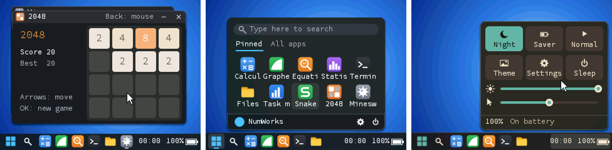

<p align="center">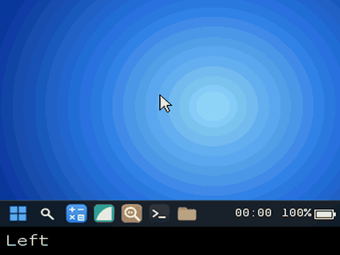</p>

> Captures prises dans le simulateur (batterie affichée à 100 %, pas de jeux).
> Sur la calculatrice, les jeux `.nwa` apparaissent avec leur icône dans
> Démarrer > All apps.

## Ce que fait Windows-OS

- **Bureau** : fond d'écran « bloom » en anneaux (4 thèmes), pointeur déplacé
  avec les flèches (il accélère quand on maintient la touche).
- **Barre des tâches** : bouton Démarrer, recherche, applis épinglées, fenêtres
  ouvertes (trait bleu sous l'appli active), horloge et batterie.
- **Menu Démarrer** : recherche en tapant des lettres, onglets *Pinned* et
  *All apps* (applis de la calculatrice, applis Windows-OS et jeux, sur
  plusieurs pages), Paramètres et Veille en bas.
- **Paramètres rapides** (clic sur l'horloge) : Night (couleurs chaudes),
  Saver (écran sombre), Normal, Theme (fond d'écran suivant), Settings, Sleep,
  luminosité et vitesse du pointeur.
- **Clic droit** (touche *boîte à outils*) : « Open / Unpin from taskbar » sur
  la barre des tâches, épingler depuis le menu Démarrer, menu du bureau
  (Gestionnaire des tâches, fond d'écran, actualiser), menu des fenêtres.
- **Fenêtres** : barre de titre, réduire, fermer, déplacer (clic sur le titre,
  flèches, clic pour poser), plusieurs fenêtres empilées.
- **Applis Windows-OS** :
  - *Terminal* : `help`, `ls`, `cat`, `rm`, `mem`, `bat`, `uptime`,
    `time HH:MM` (règle l'horloge), `apps`, `open APP`, `theme`, `exit`…
  - *Files* : fichiers de la calculatrice (scripts Python, listes,
    fonctions…), Ouvrir, Supprimer (avec confirmation), Actualiser.
  - *Task manager* : fenêtres ouvertes (*End task*), performances (stockage,
    batterie, temps depuis le démarrage, durée d'affichage), lancement d'applis.
  - *Snake*, *2048*, *Minesweeper* (clic gauche pour ouvrir, clic droit pour
    poser un drapeau, ou au clavier).
- **Barre de titre bleue** dans les applis de la calculatrice.
- **Installateurs en un clic pour Mac et pour Windows** : une page web locale
  qui détecte la calculatrice, gère tes jeux (glisser-déposer) et installe tout.

| Menu Démarrer | Toutes les applis | Recherche |
| --- | --- | --- |
| 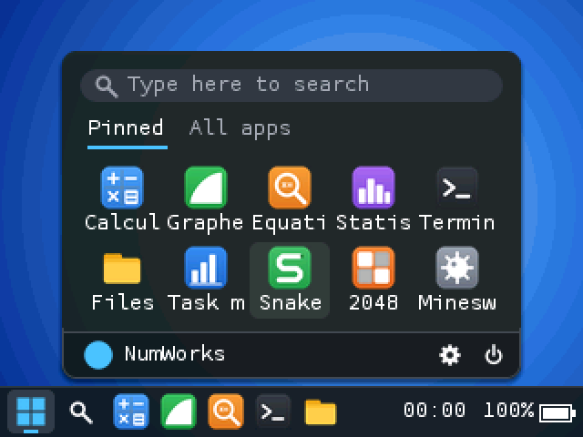 | 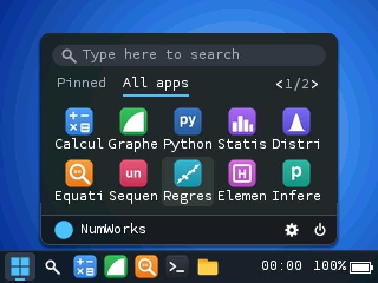 | 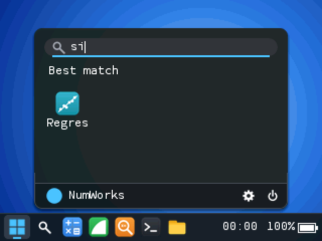 |

| Paramètres rapides | Gestionnaire des tâches | Fichiers |
| --- | --- | --- |
| 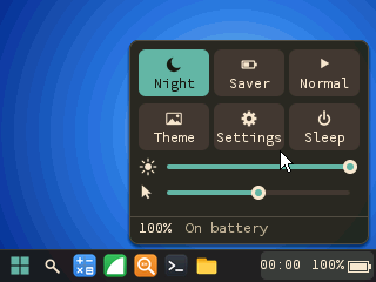 | 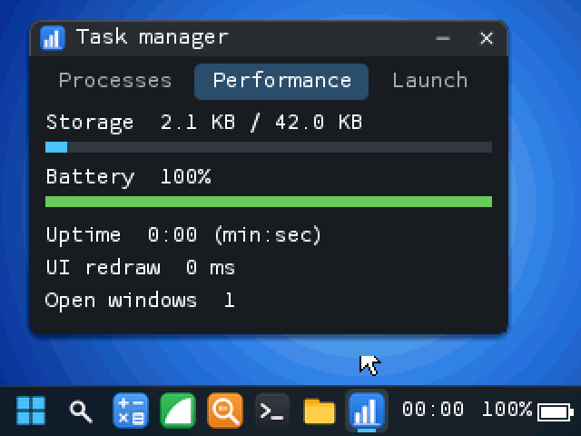 | 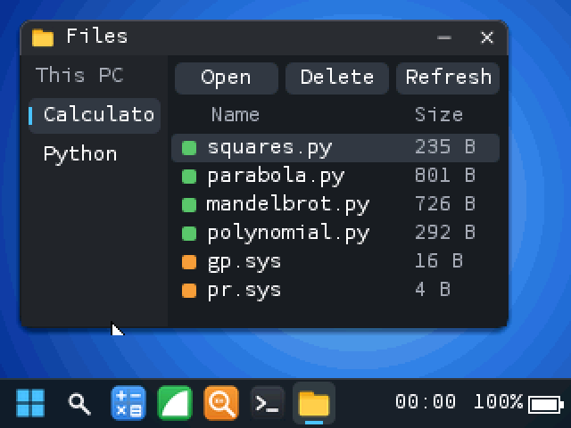 |

| Terminal | Clic droit | Snake |
| --- | --- | --- |
| 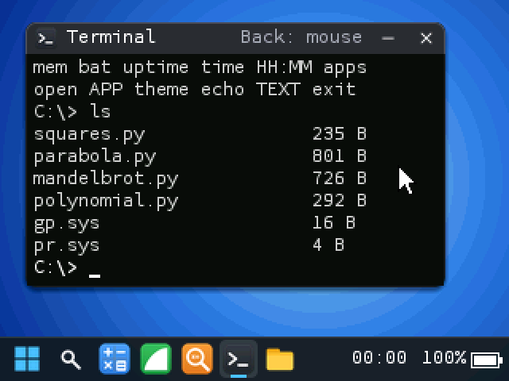 | 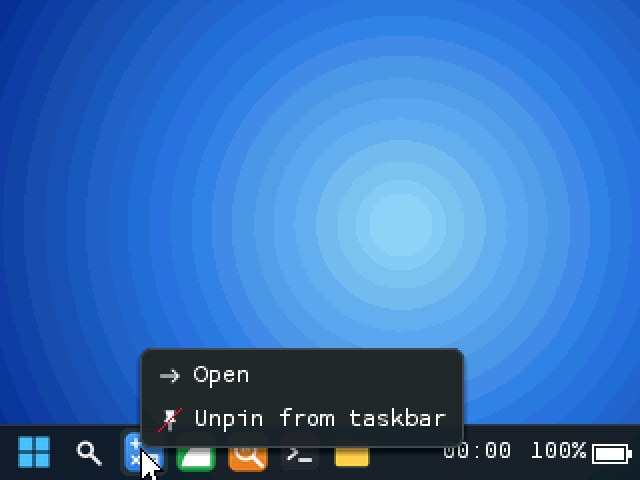 | 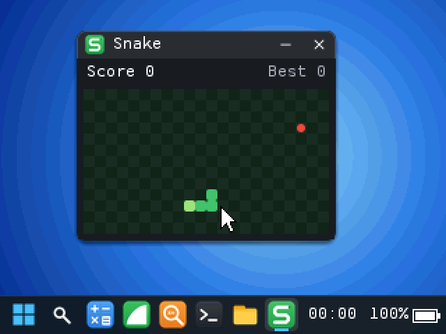 |

## Commandes

| Touche | Sur le bureau | Dans une fenêtre qui a le clavier |
| --- | --- | --- |
| Flèches | déplacer le pointeur | jouer / naviguer |
| OK ou EXE | clic | action (nouvelle partie, valider…) |
| Boîte à outils | clic droit | drapeau (Démineur) |
| Var | ouvrir / fermer le menu Démarrer | — |
| Home ou Retour | ouvrir le menu Démarrer, fermer un menu | rendre la main au pointeur (« Back: mouse ») |
| Alpha | lettres (recherche, terminal) | lettres |
| On/Off | veille | veille |

Depuis une appli de la calculatrice, **Home** ramène sur le bureau, avec les
fenêtres là où tu les avais laissées.

## Le bug Home / On-Off de PSP-OS et Switch-OS est corrigé

Sur la calculatrice, la touche **Home** ne passe pas par un événement normal :
le noyau de NumWorks fait sauter le programme à un « point de reprise »
(checkpoint) posé au démarrage, en abandonnant tout ce que l'appli en cours
était en train de faire. Les patchs de PSP-OS et Switch-OS cachaient la barre
de titre de l'écran d'accueil **avant** de fermer l'appli en cours : cela
redessinait les vues de cette appli, dont certaines contenaient des formules
déjà effacées par le saut. Résultat : accès mémoire invalide, plantage, et la
calculatrice redémarrait sur le système officiel.

Windows-OS ferme d'abord l'appli, puis change la barre de titre
(`apps/apps_container.cpp` dans le patch). Le bug a été reproduit puis vérifié
corrigé dans le simulateur en imitant le noyau (Home et réveil après On/Off
par le point de reprise), sur toutes les applis et sur des milliers de
touches au hasard. Windows-OS n'utilise pas non plus d'animation continue :
il respecte le délai minimum d'attente des événements imposé par le système.

## Installation

### 1. Obtenir Windows-OS

Depuis juillet 2021, le code d'Epsilon (le logiciel de la NumWorks) n'est plus
sous licence libre. Windows-OS ne publie donc **aucun code ni aucun firmware
de NumWorks** : seulement un **patch** (`patches/windows-os-epsilon.patch`) et
son propre code. Le firmware se compile à partir des sources officielles de
NumWorks, dans ton compte GitHub ou sur ton Mac.

**Sans rien compiler (Mac ou Windows)**

1. En haut de cette page : **Use this template** > **Create a new repository**,
   coche **Private** (obligatoire : la compilation refuse de tourner dans un
   dépôt public, pour que le firmware ne soit pas téléchargeable par tous).
2. Facultatif : ajoute tes jeux `.nwa` dans le dossier `games/` de ta copie
   privée (*Add file* > *Upload files*). Ils seront préparés et inclus dans
   l'installateur.
3. Dans ta copie : onglet **Actions** > **Build Windows-OS** > **Run workflow**.
4. Environ 15 minutes plus tard, en bas de la page de la compilation,
   télécharge **Windows-OS-Mac** ou **Windows-OS-Windows** et décompresse-le
   (deux fois pour la version Mac : GitHub met le zip dans un zip).

**En compilant sur ton Mac**

```bash
brew install make dfu-util libusb
brew install --cask gcc-arm-embedded
git clone https://github.com/derim00/windows-os.git && cd windows-os
./scripts/build-firmware.sh
```

Le script télécharge Epsilon au commit indiqué dans `EPSILON_COMMIT`
(Epsilon 26.1, la dernière version publiée par NumWorks), applique le patch,
compile, prépare les jeux de `games/` et remplit le dossier `installer/`.

### 2. Installer sur la calculatrice

**Sur Mac**

1. Une seule fois : `brew install libusb dfu-util` (et
   `brew install --cask gcc-arm-embedded` pour ajouter d'autres jeux).
2. Double-clique sur **`Installer Windows-OS.command`** (la première fois :
   clic droit > **Ouvrir**). La page de l'installateur s'ouvre
   (http://127.0.0.1:8767).

**Sur Windows** (rien à installer : ni Python, ni pilote)

1. Décompresse **Windows-OS-Windows** (clic droit > *Extraire tout*) : ne
   lance pas l'installateur depuis l'intérieur du zip.
2. Dans le dossier `Windows-OS`, double-clique sur
   **`Installer Windows-OS.exe`** (si SmartScreen s'affiche :
   *Informations complémentaires* > *Exécuter quand même*). Une fenêtre noire
   s'ouvre avec la page de l'installateur dans ton navigateur : laisse-la
   ouverte, et ferme-la à la fin pour quitter. Comme pour NumSocial, l'`.exe`
   contient Python et libusb, et la calculatrice se déclare comme
   périphérique WinUSB : Windows la reconnaît sans pilote.

**Ensuite, sur les deux**

3. Branche la calculatrice en USB et appuie sur **Reset** au dos : elle
   redémarre sur le système officiel.
4. Quand le voyant passe au vert, glisse tes jeux `.nwa` dans la page si tu
   veux, puis clique sur **Installer Windows-OS**.
5. Sur la calculatrice, passe l'écran « logiciel non officiel » avec une
   touche : le bureau apparaît.

L'installateur vérifie que le **slot B** est libre avant d'écrire : le système
officiel (slot A) n'est jamais modifié. Il place les jeux juste après
Windows-OS dans le slot B (l'adresse est lue dans le firmware compilé), les
copie, les relit pour les vérifier, puis installe
Windows-OS et le démarre.

## À savoir

- **Calculatrice** : NumWorks **n0120**, avec le logiciel officiel
  **26.4.0** dans le slot A. Windows-OS est compilé à partir d'Epsilon 26.1
  (la dernière version publiée) avec le numéro de version 26.4.0.
- **Après un Reset**, la calculatrice revient sur le système officiel :
  Windows-OS reste dans le slot B, il suffit de relancer l'installation.
- **Un seul système dans le slot B** : Windows-OS remplace
  [Switch-OS](https://github.com/derim00/switch-os) ou
  [PSP-OS](https://github.com/derim00/psp-os) s'il était installé, et
  inversement. Les installateurs utilisent des ports différents (8765, 8766,
  8767).
- **Horloge** : la calculatrice n'a pas d'horloge temps réel ; l'heure part de
  00:00 au démarrage. Règle-la avec `time 14:30` dans le Terminal.
- **Jeux sur Windows** : les jeux déjà présents dans `games/` lors de la
  compilation sont prêts ; pour en ajouter d'autres directement depuis
  Windows, il faut la chaîne ARM
  ([Arm GNU Toolchain](https://developer.arm.com/downloads/-/arm-gnu-toolchain-downloads),
  version *arm-none-eabi*).
- **Jeux** : seulement des applis `.nwa` dont tu as le droit de te servir, et
  uniquement dans ta copie privée : jamais dans ce dépôt public.

## Comment c'est fait

| Fichier | Rôle |
| --- | --- |
| `patches/windows-os-epsilon.patch` | le bureau (`apps/home/win`), le correctif Home/On-Off (`apps/apps_container.cpp`), la barre de titre bleue |
| `apps/home/win/shell.cpp` (dans le patch) | barre des tâches, menu Démarrer, paramètres rapides, clic droit, fenêtres |
| `apps/home/win/apps.cpp` (dans le patch) | Terminal, Files, Task manager, Snake, 2048, Minesweeper |
| `apps/home/win/gfx.cpp` (dans le patch) | rendu par bandes en RAM, texte, icônes, fond d'écran |
| `apps/home/win/gen_icons.py` (dans le patch) | génère les icônes (`win_icons.h`) |
| `scripts/build-firmware.sh` | télécharge Epsilon, applique le patch, compile, prépare les jeux et l'installateur |
| `installer/server.py` | serveur local (127.0.0.1 uniquement) de l'installateur, Mac et Windows |
| `installer/dfu_launch.py` | lance l'outil DFU de NumWorks avec libusb (Homebrew ou `libusb-package`) et les correctifs Windows de NumSocial |
| `scripts/build-windows-installer.py` | fait `Installer Windows-OS.exe` avec PyInstaller (sur Windows, dans le workflow) et le teste |
| `installer/link_games.py` | place chaque jeu `.nwa` à son adresse dans le slot B, comme le site de NumWorks |
| `installer/Installer Windows-OS.command` | lanceur en double-clic pour Mac |
| `.github/workflows/build.yml` | compilation dans ta copie privée, avec les deux installateurs |

## Licence

Le code de Windows-OS est sous licence **CC BY-NC-SA 4.0** (voir `LICENSE`).
Epsilon reste la propriété de NumWorks et n'est pas inclus dans ce dépôt.
Windows-OS est un projet de fan, sans lien avec Microsoft ni avec NumWorks ;
Windows est une marque de Microsoft. Les icônes et fonds d'écran sont des
dessins originaux faits pour ce projet.
